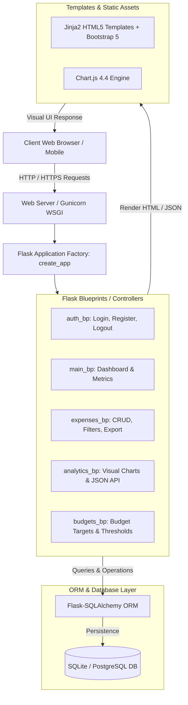
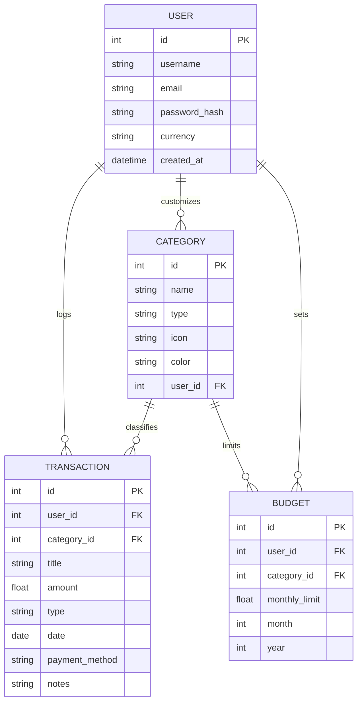

# Academic Project Submission Report
## Personal Expense Tracker Web Application

---

### 1. Project Title & Metadata
- **Project Name:** Personal Expense Tracker Web Application (ExpenseWise)
- **Domain:** Web Development / FinTech / Full-Stack Software Engineering
- **Technologies Used:** Python 3, Flask, SQLite / PostgreSQL, Flask-SQLAlchemy, Flask-Login, HTML5, CSS3, JavaScript, Bootstrap 5, Chart.js
- **Target Audience:** Individual Users, College Students, Freelancers, Small Business Owners

---

### 2. Abstract
Managing personal finances, monitoring daily spending habits, and adhering to monthly budgets are critical challenges in today's digital economy. The **Personal Expense Tracker Web Application** is a responsive full-stack solution engineered to simplify financial management. It allows users to log both income and expenditure, organize transactions by category and payment channel, set monthly budgets with automated threshold warnings, and visualize spending habits through interactive analytical dashboards. Built using Python Flask and SQLAlchemy, the system emphasizes data security, intuitive UI/UX design, and modular architecture.

---

### 3. Objectives of the System
1. **User Authentication & Session Security:** Implement secure registration and login using industry-standard password hashing (`Werkzeug`) and session state preservation via `Flask-Login`.
2. **Transaction Management (CRUD):** Provide robust Create, Read, Update, and Delete operations for both income and expense records.
3. **Multi-Criteria Querying & Filtering:** Enable users to filter records across categories, payment methods, date ranges, and text search queries.
4. **Visual Data Analytics:** Integrate Chart.js to render real-time interactive charts (Category Doughnut, Income vs. Expense Comparison, 30-Day Spending Trend, Payment Channel Distribution).
5. **Budget Monitoring & Threshold Alerts:** Allow users to define monthly category budgets that dynamically warn users when spending exceeds 80% or breaches 100% of the set limit.
6. **Data Export & Reporting:** Allow one-click CSV export and clean printable financial statements for tax and bookkeeping needs.

---

### 4. System Architecture

The application adopts the **Model-View-Controller (MVC) / Application Factory** architectural pattern:

---

### 5. Database Schema & Entity Relationships

The relational database comprises four core entities:

#### 1. `users` Table
- `id` (INTEGER, Primary Key, Auto-increment)
- `username` (VARCHAR(64), Unique, Indexed, Not Null)
- `email` (VARCHAR(120), Unique, Indexed, Not Null)
- `password_hash` (VARCHAR(256), Not Null)
- `currency` (VARCHAR(10), Default '₹', Not Null)
- `created_at` (DATETIME, Default UTC)

#### 2. `categories` Table
- `id` (INTEGER, Primary Key, Auto-increment)
- `name` (VARCHAR(64), Not Null)
- `type` (VARCHAR(10), 'expense' | 'income')
- `icon` (VARCHAR(64), Bootstrap icon class)
- `color` (VARCHAR(20), Hex code)
- `user_id` (INTEGER, Foreign Key -> `users.id`, Nullable)

#### 3. `transactions` Table
- `id` (INTEGER, Primary Key, Auto-increment)
- `user_id` (INTEGER, Foreign Key -> `users.id`, Cascade Delete)
- `category_id` (INTEGER, Foreign Key -> `categories.id`)
- `title` (VARCHAR(120), Not Null)
- `amount` (FLOAT, Not Null)
- `type` (VARCHAR(10), 'expense' | 'income')
- `date` (DATE, Not Null)
- `payment_method` (VARCHAR(30), Default 'UPI / GPay')
- `notes` (TEXT, Nullable)
- `created_at` (DATETIME, Default UTC)

#### 4. `budgets` Table
- `id` (INTEGER, Primary Key, Auto-increment)
- `user_id` (INTEGER, Foreign Key -> `users.id`, Cascade Delete)
- `category_id` (INTEGER, Foreign Key -> `categories.id`)
- `monthly_limit` (FLOAT, Not Null)
- `month` (INTEGER, 1 to 12)
- `year` (INTEGER, e.g., 2026)
- `created_at` (DATETIME, Default UTC)

---

### 6. Module Descriptions

| Module | Location | Purpose & Implementation |
|---|---|---|
| **App Factory & Configuration** | `app/__init__.py`, `config.py` | Configures extensions, initializes database, registers context processors, sets currency formatting filter. |
| **Authentication Module** | `app/routes/auth.py` | Registration with validation, login with `remember_me`, logout, user profile & currency switcher. |
| **Dashboard Module** | `app/routes/main.py` | Central landing page calculating real-time balance, monthly income, monthly expenses, savings rate, and recent transactions. |
| **Expenses & Ledger Module** | `app/routes/expenses.py` | Full transaction CRUD, keyword search, category & date filters, pagination, CSV export generator. |
| **Visual Analytics Module** | `app/routes/analytics.py` | Provides asynchronous JSON endpoints aggregating monthly statistics for Chart.js rendering. |
| **Budget Monitoring Module** | `app/routes/budgets.py` | Handles monthly category budget allocations, progress calculations, and status evaluation. |

---

### 7. Security Features
- **Salted Password Hashing:** Uses `werkzeug.security.generate_password_hash` with modern PBKDF2/SHA-256 algorithms. Plaintext passwords are never stored.
- **Route Authorization:** All sensitive views are shielded by Flask-Login's `@login_required` decorator.
- **Data Isolation:** User queries enforce strict `user_id == current_user.id` filters to eliminate unauthorized horizontal access.
- **SQL Injection Prevention:** Utilizes SQLAlchemy ORM parameterized queries exclusively.

---

### 8. Common Viva & Interview Questions & Answers

**Q1: Why did you choose Flask over Django for this project?**
> *Answer:* Flask is a lightweight microframework that provides flexibility without imposing rigid directory structures. For a personal finance tracker, Flask allows a modular Blueprint architecture, minimal overhead, rapid API development for Chart.js, and lightweight memory footprint suitable for free-tier cloud deployment on Render or Railway.

**Q2: What is an ORM and why did you use SQLAlchemy?**
> *Answer:* Object-Relational Mapping (ORM) allows developers to interact with relational databases using Python classes and objects instead of raw SQL queries. SQLAlchemy provides database portability (easily switching between SQLite for local development and PostgreSQL in production without modifying business logic) and protects against SQL injection vulnerabilities.

**Q3: How does the application prevent unauthorized access to other users' transactions?**
> *Answer:* Every database query performing read, update, or delete operations explicitly filters by `user_id == current_user.id`. Even if a user attempts to manually manipulate a URL parameter (e.g. `/expenses/delete/10`), the query returns a `404 Not Found` unless the record belongs to the active session.

**Q4: How are Chart.js charts dynamically rendered?**
> *Answer:* The frontend issues an asynchronous `fetch()` request to `/api/analytics-data`. The Flask backend aggregates transaction data using SQL `func.sum()` and `db.extract()`, returning a structured JSON payload. The client-side JavaScript (`charts.js`) dynamically binds this data to HTML5 `<canvas>` elements.

**Q5: How does the budget alert system function?**
> *Answer:* When a transaction is logged or when the dashboard is loaded, the application computes the sum of expenses for that category in the active month. If the spent amount divided by the monthly limit is $\ge 1.0$, a `danger` status is assigned; if between $0.80$ and $1.0$, a `warning` status is assigned, which triggers high-priority alert banners.

---

### 9. Conclusion
The **Personal Expense Tracker Web Application** fulfills all requirements specified in the project outline. It combines a robust Python backend with a modern, responsive frontend to deliver a real-world tool that empowers users to manage money, reduce unnecessary spending, and plan their financial future.
